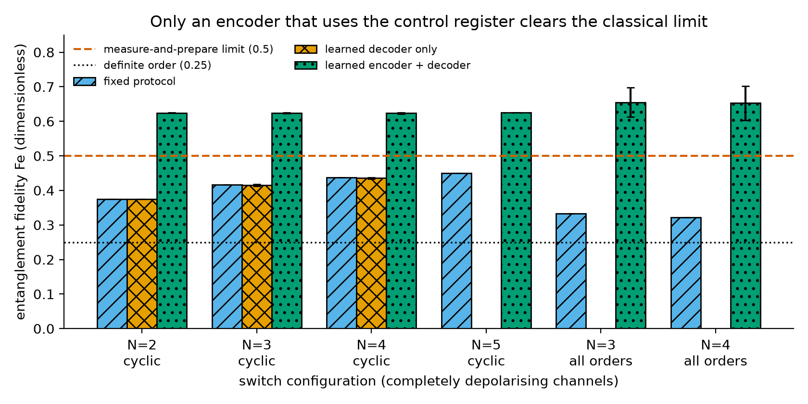
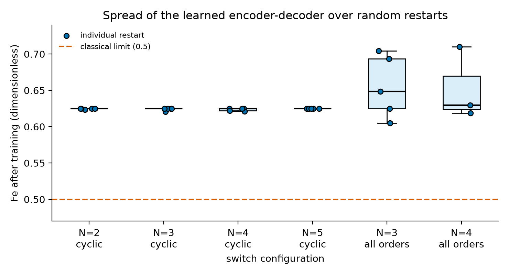
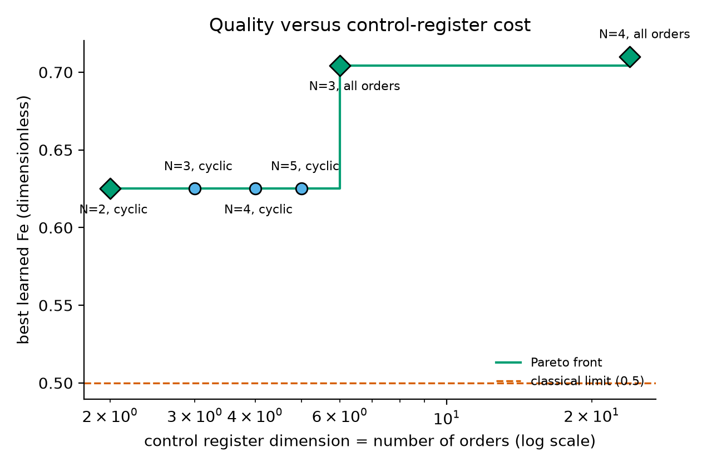
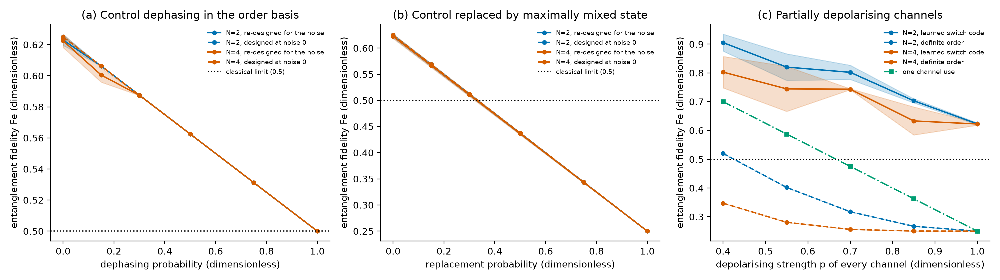
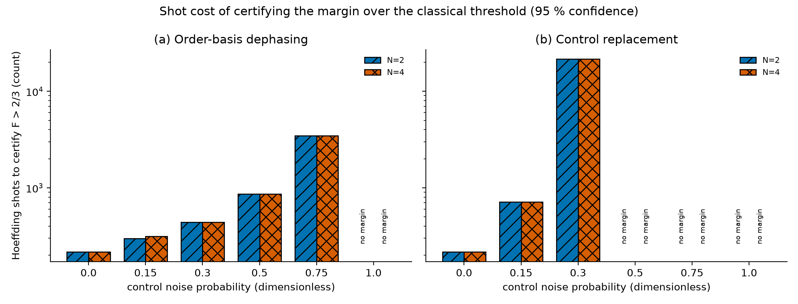
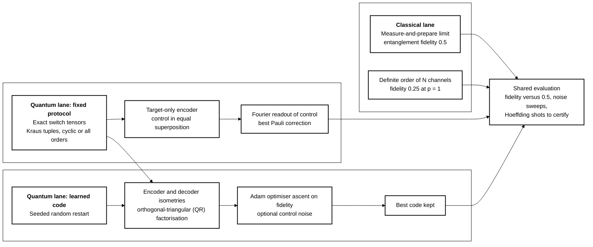

# Learned Encoder-Decoder Design for the Quantum Switch of Depolarising Channels


**Research question.** A completely depolarising qubit channel carries no information in a definite order. When several such channels are placed in a superposition of orders, how large is the fidelity margin over the classical measure-and-prepare threshold that a *designed* code can win, how does it scale with the number of channels and orders, and how much control-register noise and how many shots does it tolerate?

**Answer in one line.** In exact simulation, a gradient-designed encoder-decoder that stores the logical qubit in the target *and* the control register reaches an entanglement fidelity (Fe) of 0.6250 (average fidelity 0.7500) for 2 to 5 cyclic orders, up to 0.7100 (average fidelity 0.8066) with all 24 orders of four channels, whereas the fixed target-only protocol stays between 0.3213 and 0.4500, below the classical limit of 0.5; the margin shrinks linearly with control noise and is not recovered by re-designing the code.

## Abstract

We simulate, exactly and at density-operator level, a quantum switch that places up to five completely depolarising qubit channels in a superposition of cyclic or all orders, and design the encoder and decoder of a one-qubit code by gradient ascent in PyTorch. Against the measure-and-prepare limit (entanglement fidelity 0.5), the definite-order baseline (0.25) and the fixed target-only switch protocol (0.3213 to 0.4500), the learned code reaches 0.6250 for 2 to 5 cyclic orders and 0.7100 at best for 24 orders; a decoder-only ablation stays at the fixed-protocol value, so the use of the control register in the encoder is what matters. The margin falls as 0.625 − 0.125 λ under order-basis control dephasing and as 0.625 − 0.375 λ when the control is replaced by the maximally mixed state with probability λ, re-designing the code for the noise gives no measurable gain, and certifying an average fidelity above 2/3 needs 216 Hoeffding shots at zero noise and 21,569 shots at λ = 0.3 under replacement noise.

## What is new here

* The control register of the order-superposition switch is treated as a *learned part of the code* (encoder isometry plus joint decoder), instead of only a readout of the order.
* One exact scaling study over the number of channels (2 to 5) and over the order set (N cyclic orders versus all N! orders), including a Pareto view of fidelity against control-register size.
* A noise-oblivious versus noise-re-designed comparison under two control-noise models, and a finite-shot certification cost for the margin over 2/3, none of which the cited experiment reports.
* Honest negative results: more cyclic orders do not help, and re-designing the code for control noise does not help.

## Motivation

Noise sets the capacity of a quantum link, and a completely depolarising channel is the extreme case. A recent photonic experiment placed four such channels in a superposition of cyclic orders and measured an output fidelity above the classical threshold of 2/3 (Wang et al., 2026, digital object identifier (DOI) 10.1038/s42005-026-02698-1). Hardware groups need to know which settings of the code, the number of channels and the control quality give a certifiable margin, and how many shots the certificate costs. An exact simulator that answers these questions at laptop scale lets an experiment choose its operating point before it spends photons.

## Research gap

Wang et al. (2026, DOI 10.1038/s42005-026-02698-1) report 0.712 ± 0.013 for one configuration. Ren et al. (2026, DOI 10.1038/s41377-025-02173-6) note that most entanglement-assisted communication is still proof-of-principle. Breuer et al. (2016, DOI 10.1103/RevModPhys.88.021002) and Tanimura (2020, DOI 10.1063/5.0011599) motivate treating structured noise exactly rather than perturbatively. Learning-based receivers adapt a decoder to the channel (Kumar et al., 2026, DOI 10.1186/s13634-026-01327-x; Pan et al., 2026, DOI 10.1007/s44163-026-02499-z; Devipriya, 2026, DOI 10.1016/j.aeue.2026.156615), and Shao et al. (2027, DOI 10.1007/978-981-92-1678-9_21) are a reminder to normalise to a fundamental limit before claiming a gain. None of these papers maps, for the switch of depolarising channels, how the best attainable fidelity scales with channels and orders, whether the control register must carry data, how control noise erodes the margin, or what the certificate costs. The full related-work table (ten papers, four roles) is in `docs/RESEARCH_GAP.md`. The numbers here are exact simulations of an idealised switch and are not a reproduction of the cited experiment, which may use a different encoding and fidelity definition.

## Hypotheses

* **H1** (supported). The learned encoder-decoder gives Fe > 0.5 for every N ≥ 2 with cyclic orders, while the target-only fixed protocol stays below 0.5.
* **H2** (partly supported). All N! orders give a higher best Fe than N cyclic orders at N = 3 and 4: the best restart improves from 0.6250 to 0.7044 and 0.7100, but the mean gain (0.6552 and 0.6526) is within one restart standard deviation.
* **H3** (falsified). Re-designing the code for control noise raises the noise tolerance above that of the noise-oblivious code: the two curves coincide within restart spread.

## Results

All numbers below are copied from `results/` (tables regenerated by `experiments/make_tables.py` into `results/tables.md`). Fe is the entanglement fidelity; average fidelity is (2 Fe + 1)/3; the classical limit is Fe = 0.5 (average fidelity 2/3), and a definite order of completely depolarising channels gives 0.25.

### Scaling with channels and orders (completely depolarising channels)

| Configuration | Orders | Fixed protocol | Learned decoder only | Learned encoder + decoder (mean ± std) | Best restart | Best average fidelity | Restarts |
|---|---|---|---|---|---|---|---|
| cyclic-N2 | 2 | 0.3750 | 0.3750 ± 0.0000 | 0.6247 ± 0.0008 | 0.6250 | 0.7500 | 5 |
| cyclic-N3 | 3 | 0.4167 | 0.4151 ± 0.0027 | 0.6240 ± 0.0019 | 0.6250 | 0.7500 | 5 |
| cyclic-N4 | 4 | 0.4375 | 0.4356 ± 0.0022 | 0.6236 ± 0.0020 | 0.6250 | 0.7500 | 5 |
| cyclic-N5 | 5 | 0.4500 | – | 0.6249 ± 0.0001 | 0.6250 | 0.7500 | 5 |
| all-N3 | 6 | 0.3333 | – | 0.6552 ± 0.0430 | 0.7044 | 0.8029 | 5 |
| all-N4 | 24 | 0.3213 | – | 0.6526 ± 0.0499 | 0.7100 | 0.8066 | 3 |



*Takeaway: only the encoder that uses the control register clears the 0.5 limit; decoder-only learning does no better than the fixed protocol.*



*Takeaway: cyclic configurations converge to the same value 0.6250 almost every restart, while the all-orders runs are far more spread, so their best values are lower bounds on what a better optimiser could find.*



*Takeaway: adding cyclic orders costs control dimension without raising the best fidelity; the Pareto front jumps only when the full permutation set (6 orders at N = 3) is used.*

### Control noise (N = 2 and N = 4, cyclic orders)

Order-basis dephasing (probability λ) gives Fe = 0.6250, 0.6063, 0.5875, 0.5625, 0.5313, 0.5000 at λ = 0, 0.15, 0.3, 0.5, 0.75, 1 for the oblivious N = 2 code, i.e. 0.625 − 0.125 λ; it reaches the classical limit exactly at full dephasing, never below. Replacing the control by the maximally mixed state with probability λ gives 0.6250, 0.5688, 0.5125, 0.4375, 0.3438, 0.2500 at the same grid, i.e. 0.625 − 0.375 λ, crossing 0.5 between λ = 0.3 and 0.5 (about 0.33 by linear interpolation of the grid). Re-designed codes (three restarts each) match the oblivious code to within 0.0060 or better in every cell; full tables are in `results/tables.md`, raw rows in `results/noise_dephasing.csv` and `results/noise_replacement.csv`.



*Takeaway: the fidelity margin decays linearly with control noise and re-designing the code does not move the curves; panel (c) shows the learned switch code far above a definite order of the same channels when the channels are weakened.*

### Weaker channels (depolarising strength p, mean ± std over 3 restarts)

| N | p | Learned switch code | Fixed protocol | Definite order | One channel use |
|---|---|---|---|---|---|
| 2 | 0.4 | 0.9052 ± 0.0296 | 0.5400 | 0.5200 | 0.7000 |
| 2 | 0.7 | 0.8020 ± 0.0247 | 0.3787 | 0.3175 | 0.4750 |
| 2 | 1.0 | 0.6230 ± 0.0034 | 0.3750 | 0.2500 | 0.2500 |
| 4 | 0.4 | 0.8027 ± 0.0548 | 0.4120 | 0.3472 | 0.7000 |
| 4 | 0.7 | 0.7433 ± 0.0017 | 0.3930 | 0.2561 | 0.4750 |
| 4 | 1.0 | 0.6225 ± 0.0043 | 0.4375 | 0.2500 | 0.2500 |

The learned code uses the control register as a second transmitted qubit (register dimension 2C), whereas the definite-order and one-channel references use one qubit, so the gap in this table is not a pure causal-order advantage. The comparison that isolates quantum behaviour is with the 0.5 limit.

### Cost of certifying the margin



*Takeaway: the shots needed to certify an average fidelity above 2/3 grow from 216 at zero noise to 3,451 at 0.75 dephasing and to 21,569 (N = 2) at 0.3 replacement noise, and are infinite once the margin vanishes.*

At the predicted Hoeffding shot count the Monte Carlo certification rate is 0.486 to 0.543 (the bound sits at the true margin, so about half of the runs certify); at twice the count it is 0.866 to 0.885 (2000 trials per cell; `results/certification.csv`).

## Discussion

The central result is structural. For these Pauli channels, a target-only encoding cannot cross the 0.5 limit, however the control is read out: the optimised decoder (0.3750, 0.4151, 0.4356 for N = 2, 3, 4) only matches the fixed protocol (0.3750, 0.4167, 0.4375). Crossing it requires an encoder that spreads the logical qubit over the target and the control, and then 2 cyclic orders already give 0.6250; 3, 4 and 5 cyclic orders add nothing. The full permutation set gives a higher best value (0.7044 at N = 3, 0.7100 at N = 4), but restarts are widely spread (std 0.0430 and 0.0499), the 24-order run uses only 3 restarts and 600 steps, and I did not establish that 0.7100 is a global optimum.

The noise results are mostly negative. Under dephasing, the full-dephasing limit lands exactly on the classical value 0.5000, which is a consistency check: a fully dephased control is a classical register. Under replacement noise the code falls below 0.5 near λ = 0.33, and a code re-designed for each λ is no better than the code designed at λ = 0, so H3 is falsified. The re-designed values are slightly *lower* (for example 0.5111 versus 0.5125 at λ = 0.3, N = 2), which reflects optimiser error, not a real penalty. The shot cost grows steeply: at 0.3 replacement noise the margin of 0.0083 in average fidelity needs 21,569 shots with a distribution-free bound, which is a pessimistic estimate that a tighter test would reduce.

## Limitations

* Idealised model: Pauli channels, a noiseless switch, noiseless encoder and decoder, and one-qubit codes. Only control noise and channel weakening are modelled; there is no transpilation depth, photon loss or detector noise.
* Best-found values come from gradient search with restarts and carry no optimality proof; the 24-order case is under-sampled (3 restarts).
* The encoder uses the control register as part of the transmitted system. The fixed, definite-order and one-channel references do not have that register, so only the comparison to 0.5 is a like-for-like quantum test.
* Hoeffding shot counts are conservative and assume ideal state preparation, measurement and decoder.
* The fixed protocol is my own reading of the standard order-readout scheme, not a copy of the protocol of any cited experiment.

## Future work

Replace the ideal decoder by a compiled circuit and add its depth and two-qubit error to the objective, port the dephasing and replacement models to a photonic-chip calibration (loss per path, phase noise), run the optimiser against measured process data rather than an ideal model, use a tighter sequential test for certification, and extend the code to two logical qubits. The same differentiable framework applies to larger order sets and to non-Pauli channels, where the Kraus-tuple enumeration would be replaced by a sampled estimator.

## Method



Legend: Kraus = operator-sum representation of a channel; QR = orthogonal-triangular matrix factorisation used to keep the isometries exact; Adam = adaptive moment estimation optimiser; p = depolarising strength; N = number of channels.

The switch applies, for each Kraus tuple of the channels, the Pauli product in the order selected by the control basis state. A code is an isometry from one logical qubit into control (x) target and a decoding channel back to one qubit; both are parametrised through the QR (orthogonal-triangular) factorisation of complex matrices and optimised with Adam (adaptive moment estimation) on the exact entanglement fidelity. Baselines, ablations (what is learned, order set), noise sweeps, seeds and metrics are specified in `docs/METHOD.md`.

## Reproducibility

```bash
pip install -e .            # numpy, scipy, pandas, matplotlib, torch
pytest -q                   # 7 tests, about 15 seconds
python experiments/run_all.py --quick   # smoke run, about 25 seconds
python experiments/run_all.py           # full study, 809 s (13.5 min) in the recorded run
python experiments/make_tables.py       # regenerates results/tables.md
```

Recorded run: Windows 11, Python 3.11.9, torch 2.11 (CPU execution, 6 threads), numpy 2.2.6, scipy 1.17.1, pandas 2.3.3, matplotlib 3.11.1, 16 logical processors, while the laptop was also used for other work. `requirements.txt` pins torch to 2.11.0. Optimisation is seeded (torch generator per restart), and a second full run produced identical table values.

## Project structure

```
src/cyclic_switch/core.py       switch tensors, fixed protocol, encoder-decoder design, shot certification
experiments/run_all.py          one-command reproduction (--quick, --reuse)
experiments/make_figures.py     five figures (Okabe-Ito palette, 200 dpi)
experiments/make_tables.py      markdown tables from results/
tests/test_core.py              fast unit tests
results/                        raw comma-separated values (CSV) and summary.json
figures/                        fig1 to fig5
docs/RESEARCH_GAP.md            literature, gap, hypotheses
docs/METHOD.md                  design, baselines, sweeps
.github/workflows/ci.yml        tests and smoke run
```

## Related work by the author

* [shot-cost-of-non-markovian-memory-witnesses](https://github.com/pradeepdegalaroyal/shot-cost-of-non-markovian-memory-witnesses): shots needed to certify memory effects on a qubit.
* [anytime-valid-shot-stopping-quantum-circuit-tests](https://github.com/pradeepdegalaroyal/anytime-valid-shot-stopping-quantum-circuit-tests): when a shot-based circuit test may stop, the sequential counterpart of the certificate cost studied here.

## Citation

```bibtex
@software{degala_cyclic_order_switch_2026,
  author  = {Degala, Chenchupradeep},
  title   = {Learned Encoder-Decoder Design for the Quantum Switch of Depolarising Channels},
  year    = {2026},
  version = {0.1.0},
  url     = {https://github.com/pradeepdegalaroyal/cyclic-order-switch-depolarizing-control-design},
  license = {MIT}
}
```

MIT license (`LICENSE`). Machine-readable metadata is in `CITATION.cff`.
